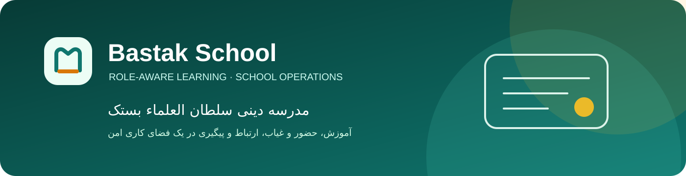

<p align="center">
  
</p>

<h1 align="center">مدرسه دینی سلطان العلماء بستک</h1>

<p align="center">
  <strong>فضای کاری امن و نقش‌محور برای آموزش، حضور و غیاب، ارتباط و پیگیری مدرسه.</strong>
</p>

<p align="center">
  <a href="README.md">English</a> · <a href="README.fa.md"><strong>فارسی</strong></a> · <a href="SHOWCASE.md">نمای محصول</a> · <a href="docs/README.md">مستندات</a>
</p>

## محصول

مدرسه بستک برای دانش‌آموز، سرپرست، دبیر، ناظر و مدیر مدرسه یک فضای کاری یکپارچه فراهم می‌کند: یادگیری، برنامه‌ریزی، حضور و غیاب، ارتباط و پیگیری. تجربه‌های Admin و Student در یک برنامه وب واکنش‌گرا ارائه می‌شوند، اما مسیرها و اقدام‌ها فقط بر پایه حساب واردشده، نقش فعال، سازمان و capability صادرشده از سرور نمایش و اجرا می‌شوند.

قرارداد API نسخه‌دار `/api/v2` و مجوزدهی سمت سرور بدون تغییر حفظ شده‌اند. CMB نیز لایه قابل‌استفاده مجدد بک‌اند است و نباید به دامنه آموزشی یا برند محصول وابسته شود.

## اجزای اصلی

| پروژه | مسئولیت | پورت محلی |
| --- | --- | ---: |
| [`apps/admin/`](apps/admin/) | تجربه وب/PWA مدیر و دانش‌آموز مدرسه بستک | `8081` |
| [`apps/api/`](apps/api/) | API و composition root مبتنی بر NestJS/Fastify | `4000` |
| [`student-core/`](student-core/) | قراردادهای دامنه دانش‌آموز، مستقل از runtime | — |
| [`packages/api-contract/`](packages/api-contract/) | مرز قراردادهای اشتراکی API | — |
| [`packages/cmb/`](packages/cmb/) | قابلیت‌های قابل‌ترکیب بک‌اند | — |

## شروع سریع

Node.js `>=22.13.0 <23` لازم است. هر پروژه lockfile مستقل خود را دارد:

```bash
npm run workspace:check
npm run bootstrap

cp apps/api/.env.example apps/api/.env
npm --prefix apps/api run migration:run
npm --prefix apps/api run dev

# در یک ترمینال دیگر
npm --prefix apps/admin run dev
```

پنل را در `http://localhost:8081` و readiness API را در `http://localhost:4000/ready` باز کنید.

برای Compose محلی:

```bash
docker compose up --build
```

نام پروژه و metadata کانتینرها با هویت مدرسه بستک تنظیم شده‌اند. از `--volumes` فقط زمانی استفاده کنید که حذف داده محلی عمدی است.

## معماری و امنیت

این مخزن یک grouped product monorepo با modular-monolith backend است. وابستگی‌ها از composition root برنامه‌ها به دامنه محصول، سپس CMB و در پایان kernel/قراردادهای عمومی جریان دارند. [ARCHITECTURE.md](ARCHITECTURE.md) و [مرزهای وابستگی](docs/architecture/dependency-boundaries.md) را بخوانید.

مجوزدهی، scope سازمان/دانش‌آموز، validation، CSRF، cookie و audit در API اعمال می‌شوند؛ مخفی‌کردن یک کنترل در UI مرز اختیار نیست.

## برند و سازگاری

منبع قابل‌ویرایش هویت ظاهری در [`apps/admin/brand.config.json`](apps/admin/brand.config.json) است. این فایل نام‌های Admin/Student را کنترل می‌کند و دستور [`npm --prefix apps/admin run brand:check`](apps/admin/package.json) همسانی metadata PWA را بررسی می‌کند.

scopeهای `@moshaver/*`، شناسه‌های `moshaver_*` برای ذخیره‌سازی/cookie/cache، نام فایل و volume دیتابیس، مستندات تاریخی و برچسب‌های credential آزمایشی فقط برای سازگاری باقی مانده‌اند. بدون برنامه migration صریح، آن‌ها را تغییر ندهید.

## اعتبارسنجی

```bash
npm run workspace:check
npm run architecture:check
npm run contracts:check
npm --prefix apps/admin run typecheck
npm --prefix apps/admin run test
npm --prefix apps/admin run build
npm --prefix apps/api run build
npm run docs:check
```

برای عملیات، [فهرست مستندات](docs/README.md)، [راهنمای توسعه تا تولید](docs/operations/development-to-production.md) و [راهنمای Coolify](docs/operations/coolify-deployment.md) را ببینید. بررسی‌های کد جایگزین آزمایش مرورگر، دستگاه، استقرار یا جریان مجاز در production نیستند.
