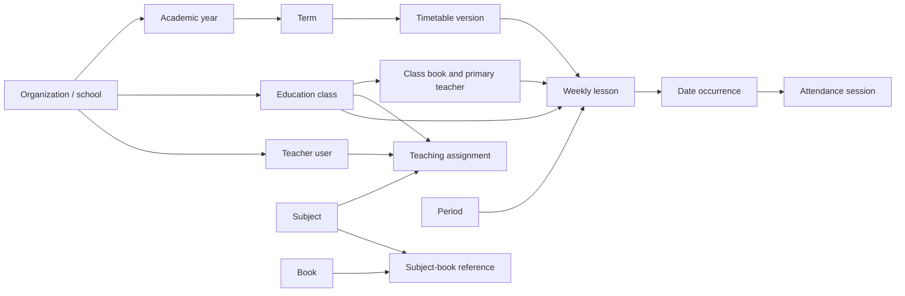

# Academic scheduling: Phase 1 audit

Status: completed on the source at `eb3dcc1` (`develop`). This is an audit only;
it does not alter production data, migrations, API behavior, or deployment state.

## Scope and evidence

The requested end state is a reliable school scheduling system that connects
academic structure, versioned timetables, lessons, attendance, and a controlled
Excel intake. This audit verified the source rather than treating those features
as absent.

- The product is a grouped monorepo with `apps/api` as the NestJS/TypeORM
  composition root, `apps/admin` as the React/Vite surface, and
  `packages/api-contract` as the shared HTTP type boundary. See
  `ARCHITECTURE.md` and `docs/architecture/repository-architecture.md`.
- `docs/reference/مبین.xlsx` is available in the active shared checkout. It is
  not yet tracked in this feature worktree, so it is an input fixture rather
  than a committed product asset until its provenance and retention policy are
  confirmed.
- Workbook inspection found five RTL sheets: four populated sheets and one
  empty sheet. The main sheet is a 69-row, 23-column weekly layout with 62
  merged ranges. It contains separate morning and afternoon time bands and
  explicit class/subject/teacher cells. `بدون خواهران` explicitly names the
  1399–1400 academic year. The workbook therefore requires source-location
  provenance, merged-cell handling, separate schedule contexts, and staff
  review for identity matching.

## Current architecture and data flow

The API owns versioned timetable state in `apps/api/src/modules/schedule/`.
`TimetableService` validates and publishes versioned weekly lessons, produces
date occurrences, records change history, and opens timetable-attendance
sessions. `AttendanceService.createTimetableSession` owns the attendance roster
snapshot after it receives a server-generated occurrence. The Admin client in
`apps/admin/src/features/schedule/` uses the existing CSRF/work-context transport
and contains the grid, lesson editor, onboarding, and import wizard.

## Feature matrix

| Area | Status | Evidence | Audit finding / next action |
| --- | --- | --- | --- |
| Organization isolation and capabilities | Existing | `timetable.controller.ts`, `academic.controller.ts` | Schedule and academic routes declare capability gates; verify every new importer action through the same server-side route guards. |
| Academic years and terms | Existing | `timetable.entity.ts`, `academic-scheduling-implementation.md` | Scoped years/terms, active-year constraint, and date ranges already exist. Do not add a parallel `AcademicYear` model. |
| Classes and enrollment history | Existing / partial | `education-class.entity.ts`, `academic-structure.entity.ts`, `classes.service.ts` | Current roster and append-only mutation snapshots exist. Historical effective-dated enrollment is not yet modeled; do not infer it from the workbook. |
| Teachers and dated responsibilities | Existing | `TeachingAssignment`, `academic.service.ts` | Explicit class/subject/teacher/date assignment exists. The primary lesson teacher remains singular. |
| Subjects and books | Existing | `SubjectBookReference`, `EducationClassBook` | Subjects are deliberately distinct from class books. A lesson still requires a class-book reference; subject-only lessons need a compatible expansion. |
| Bell schedules, periods, morning/afternoon | Existing | `TimetableBellSchedule`, `TimetableDailySession`, `TimetablePeriod` | Explicit time intervals and weekday-limited periods support the workbook's two time bands. Invalid or uncertain times must remain unpublishable. |
| Versions, publication, history | Existing | `TimetableVersion`, `TimetableChange`, `timetable.service.ts` | Draft/publish/archive, revisions, date overrides, and history are implemented. Preserve approved history. |
| Conflict detection | Existing | `timetable-domain.ts`, `timetable.service.spec.ts` | Class, teacher, room, availability, capacity, and allocation conflicts use actual time intervals and occurrences. Maintain hard-conflict versus review-warning semantics in future UI. |
| Excel intake | Partial | `TimetableImportWizard.tsx`, `timetable-workbook.ts`, `/import/preview`, `/import/commit` | A version-scoped review/commit path exists, but Phase 2 must prove it parses this workbook's repeated headers, merged cells, RTL structure, and multiple contexts without fabricated matches. |
| Attendance integration | Existing / partial | `TimetableOccurrence`, `AttendanceService.createTimetableSession` | Occurrence identity and attendance session linkage exist; canceled/restored/reassigned changes protect recorded attendance. Substitute-specific authorization and historical enrollment dates require explicit gap verification. |
| Admin, teacher, and student views | Existing / partial | `TimetablePage.tsx`, `TimetableToday.tsx`, occurrence APIs | The Admin timetable UI exists. Phase 4 must verify role-specific teacher/student journeys and responsive behavior against live APIs before claiming completeness. |
| Notifications and reporting | Partial | existing notification modules; no audited schedule-change consumer | Do not add notifications until an event owner and recipient rules are identified. Planned-vs-held reporting is also unverified. |

## Workbook-specific findings

The input is not a normalized import table. It has repeated headers, merged
cells, blank schedule slots, visibly separate morning/afternoon layouts, and
at least one historical year label. It also contains teacher spellings that
cannot safely be merged by normalization alone. The importer must retain:

1. original sheet, row, column, and raw cell values;
2. sheet/context boundaries rather than flattening all tabs into one timetable;
3. explicit `UNKNOWN`/unresolved identities and absent period times;
4. a staff-reviewed mapping before a commit; and
5. a stable idempotency key based on the approved source/context mapping, not a
   guessed production identifier.

## Gap backlog, in dependency order

### Phase 2 — workbook extraction and import-contract audit

Create a read-only staged extraction for `مبین.xlsx`: sheet metadata, merged
regions, header blocks, candidate class/subject/teacher/period rows, and
ambiguities. Compare its representation with `TimetableImportRow` and document
every unsupported source shape. Add fixtures that preserve the workbook cases;
do not write business data.

### Phase 3 — safe importer completion

Extend the existing timetable importer only where Phase 2 proves a gap. The
required workflow is upload → parse → normalize → match → validate → preview →
explicit confirm → commit → report. It must be capability-gated, bounded,
transactional, idempotent, auditable, and reject unresolved identity/time
mappings. Any file upload must validate type, size, and tenant/version scope.

### Phase 4 — complete user journeys

Verify and fill only demonstrable gaps in the Admin timetable workspace and
teacher/student occurrence views: filters, conflicts, draft/published state,
history, attendance entry, RTL desktop grid, and mobile agenda behavior. Use
the current feature components, `CapabilityGate`, and one shared data flow per
viewport.

### Phase 5 — attendance, notifications, and operations

Test occurrence-to-attendance behavior through canceled, changed, substituted,
and historical lessons. Add schedule-change notifications and planned-versus-
held reporting only after defining an owner, audience, audit record, and
failure/retry behavior.

### Phase 6 — production-readiness verification

Run migration rehearsal against a disposable SQLite copy, authorization and
tenant-isolation tests, importer fixture tests, API/Admin checks, and responsive
browser checks. Record each result as PASS, FAIL, or NOT VERIFIED. PostgreSQL
and multi-process conflict serialization remain a separate portability phase.

## Phase 2 acceptance criteria

Phase 2 is complete only when a read-only extraction proves all of the
following:

- every populated workbook sheet is classified as current, historical, special,
  or unresolved without silently combining contexts;
- each candidate lesson retains source coordinates and raw values;
- each class, teacher, subject, book, weekday, and time mapping has a confidence
  and review state;
- conflicts and missing/invalid times are reported without being auto-corrected;
- the output identifies precisely which rows can become existing
  `TimetableImportRow` data and which require a contract extension; and
- no production entity, timetable version, or attendance record is written.

## Risks and guardrails

- The workbook is not yet a tracked fixture in this feature worktree. Preserve
  it unchanged and obtain an explicit retention decision before committing it.
- Do not recreate entities already owned by the schedule and school-education
  modules.
- Do not accept a client-selected table/entity name, role, organization, or
  teacher identity during import.
- Do not publish a schedule with unresolved mappings, uncertain time intervals,
  or hard conflicts.
- Do not rewrite recorded attendance or historical approved occurrences.
