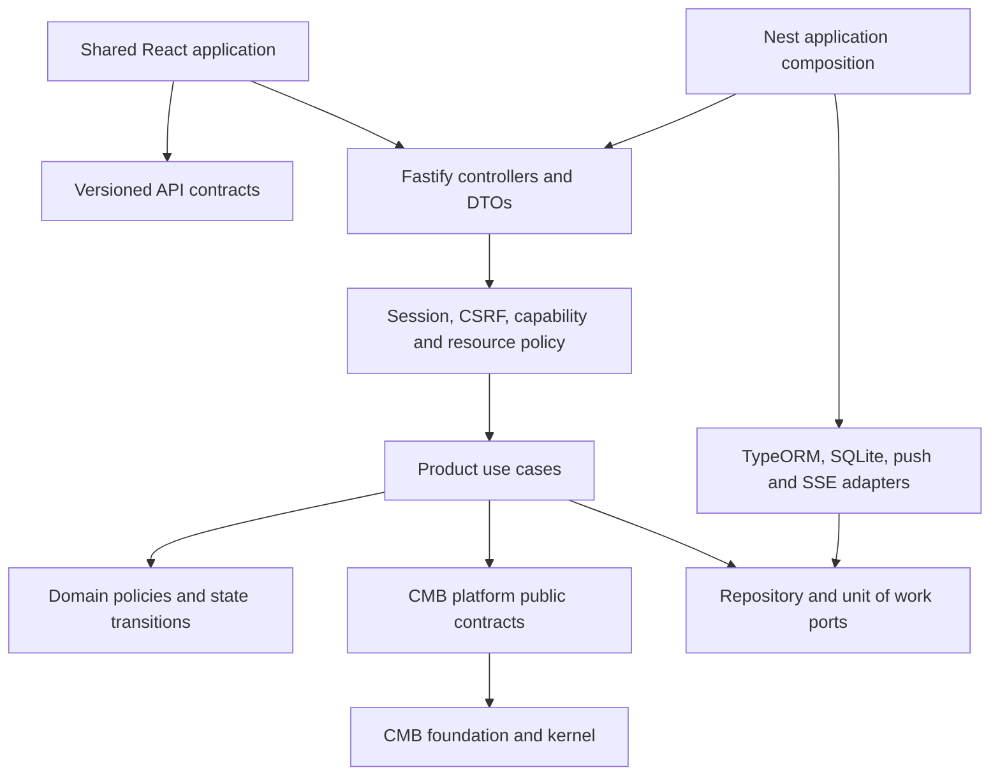

# Bastak School target architecture

Proposed incremental target, grounded in baseline `5871ae5614c3534fb1dde9195f4e3e9eff067bd4`. This document describes future work, not completed extraction. See [current-state.md](current-state.md) for evidence and [refactor-plan.md](refactor-plan.md) for ordering.

## Architecture decision

Retain the grouped product monorepo and one NestJS/Fastify modular-monolith API. Keep the shared React application for staff, students and guardians, selected by verified work context and capabilities. Preserve `/api/v2`, leaf lockfiles, current folder paths and existing CMB public APIs. There is no measured operational reason for microservices, a new workspace framework, a second student UI or a wholesale ORM rewrite.

Start by improving ownership inside `apps/api/src/modules`; physically extracting packages follows demonstrated consumers and stable boundaries. Infrastructure implements ports owned by use cases/platform; product rules do not move into `packages/cmb`. Host-level operational tools remain explicitly privileged adapters.

## Product ownership and interfaces

| Boundary | Owned writes/schema | Public collaboration surface |
| --- | --- | --- |
| Identity and access | accounts, sessions, credential/throttle state, organizations, memberships, role assignments/grants | authenticate, resolve work context, authorize tenant/resource, provision/revoke account; product student-status eligibility via an injected policy |
| Student records | primary school ownership, student lifecycle/core, profile and contacts | StudentDirectory queries, StudentAdministration commands, active-student eligibility, registration profile update contract |
| Registration | requirements, section progress/review and derived registration lifecycle | transactional completion/review use cases; use Student records for profile/contact writes and Catalogue for valid selections |
| Education catalogue/classes | catalogue/books, classes, teaching assignments, enrollments, study groups | scoped catalogue policy, class roster/teacher eligibility queries, book deletion impact query |
| Schedule | terms, periods, locations, draft/published versions, lessons and overrides | conflict checking, publish/override commands, occurrence query and stable published events |
| Attendance | sessions/roster snapshots, physical marks, review state, revisions, receipts, pools/delegates | occurrence materialization, mark/review/check-in commands and attendance summary queries |
| Residence | rooms, current assignments and placement history when explicitly introduced | transactional placement/move; room/roster eligibility query |
| Student requests | leave/exit/return/letters and approval state | request/review/movement commands, occupancy projection; attendance integration through explicit contracts |
| Relationships/community | guardian/advisor relationships, school announcements/prayer configuration, conversation state | relationship policy, scoped home/feed and chat participant contracts; keep these separate modules where their ownership differs |
| Historical learning/exams | retained plans/tasks/exams/reports/learning schemas | explicit compatibility APIs and owner queries; no deletion merely because module composition is dormant |
| Transfers/operations | feature-owned imports/history; privileged backup/reset/release/audit adapters | allowlisted feature schemas, scoped exports, preview and atomic commit; maintenance operations under admission control |

A migration ownership ledger must assign **every** table and migration to one owner, including legacy data and infrastructure state. New migration IDs should follow existing compatibility requirements and owner metadata; do not renumber historical TypeORM migrations. Cross-domain reads can use owner-provided projections; a read-only reporting adapter may perform approved joins with declared ownership. It must not become another writer.

## Security and transport invariants

Controllers translate validated DTOs into commands and return explicit response DTOs. ORM entities never define the public response contract. Every sensitive nested user projection must be allowlisted; default-hidden credentials are defense in depth, with login queries explicitly authorized to select credential fields.

Resolve authority once per request: active subject/session, requested role, selected active tenant, capabilities/feature entitlements, then resource policy. A membership found in another tenant cannot authorize that tenant using capabilities from the current tenant. Cross-school administration must use an explicit server policy, including the existing platform administrator semantics. Unknown contexts fail closed. Public endpoints should be explicitly inventoried; preserve their deliberate anonymous access rather than replacing all routes with an indiscriminate authentication requirement.

Maintain HttpOnly access/refresh cookies, CSRF on authenticated mutations, persisted throttling, revocation/deactivation and scoped relationships. Refresh and context-switch behavior must retain browser concurrency protections and query-cache clearing. Add bounded SSE reauthorization or connection lifetime based on threat tests. DTOs enforce nested allowlists and size limits; domain use cases enforce relationship, catalogue, capacity, temporal and transition invariants.

## Transactions, migrations and events

Introduce a host-owned unit of work that serializes SQLite writes where required and supplies one transaction manager to all participating repository ports. Move the currently attendance-named transaction helper only after all consumers and concurrency tests are known; it is infrastructure behavior, not an Attendance business rule. Keep explicit synchronous transactions for signup/account creation, placement, registration changes, attendance writes, timetable publication and import commits.

Place capacity/uniqueness/relationship invariants in database constraints when their semantics are settled. For residence, first decide whether current placement is unique globally or per school; inspect conflicting rows and report ambiguity before enforcing it. Never infer an automatic destructive cleanup policy.

Record domain changes and required notification work atomically via an outbox only when delivery requirements justify it. After commit, an idempotent bounded worker delivers events/notifications and records retries/failure outcomes. In-process SSE remains a delivery channel; reconnection uses authorized reads of durable state. Avoid declaring a queue abstraction sufficient proof of reliable execution. No broker is required merely to implement a single-process outbox worker.

Rehearse migration-from-zero and upgrade from representative sanitized snapshots. Preserve historical repair semantics and schema dependencies. Operations take a consistent backup before schema-changing rollout; recover forward-only repairs through a rehearsed restore, not blind `migration:revert`. Remote restore stays unavailable until transport, admission control, verification and recovery all work.

## Frontend shape

Keep `app` for composition/routing/providers/shell, `features` for use cases and data flow, `shared` for design tokens, API infrastructure and generic UI. Pages coordinate feature hooks and components; reducers/state machines own complex timetable/student editing interactions where they provide a concrete benefit. Split oversized pages by cohesive interaction rather than arbitrary line count.

Use public API contract response types and runtime boundary validation where untrusted payloads warrant it. Query keys include request identity dimensions; the existing context-change cache-clear event remains enforced. Preserve one responsive flow, keyboard/focus behavior, reduced motion, loading/empty/error states, Persian/RTL, theme and capability-based navigation/routes. Registration completion remains explicitly unavailable until its full backend/UI path passes the release tests; excluded drafts are not part of the active product.

Do not extract another shared UI or Student package without a real second consumer or ownership reason. Retain runtime neutrality of `student-core`; do not add React/browser/native APIs to make it easier to integrate.

## Observability and scaling

Set request correlation before guards; record method, normalized route, status, safe error code, elapsed time and authorized audit context without raw credentials/personal payloads. Add event-loop lag, write queue wait/busy errors, response latency, job/outbox failures, SSE connections, disk/WAL/backup age and readiness alerts. Audit is durable business evidence, distinct from diagnostic logs.

Keep one API process/replica and local persistent SQLite storage until measured workloads exceed the supported envelope. Use pagination/projections/aggregate counts and measured indexes first. PostgreSQL is a separate ADR and implementation phase: SQLite-specific SQL, migrations, constraints, backups and transaction behavior require compatibility tests. CMB ports and descriptors reduce migration cost but do not make a connection-string change portable.

Use the tested-SHA LAN release path, immutable release identification and off-host retained backups. Alternate profiles must build the real shared UI. Verify private workflow parity and live protections separately; repository YAML cannot prove them. Service extraction requires a measured scaling/SLO/team/security need and an operational ADR.

## Enforceable acceptance criteria

1. No credential fields appear anywhere in public schedule responses.
2. A privileged role in school A cannot exercise that authority in school B through membership-only checks.
3. Related updates and import batches either commit together or leave previous state intact under injected failure.
4. All mounted mutation bodies have explicit runtime schemas, bounded arrays/text and negative tests.
5. Each domain has one authoritative writer; remaining cross-owner reads/writes are listed with a migration owner and exit criterion.
6. Existing HTTP shapes, error codes and permission behavior remain compatible unless separately reviewed.
7. Architecture, security, migration, UI accessibility and deployment checks pass without weakening existing gates.
8. Production restoration and single-writer deployment assumptions are exercised on disposable infrastructure before release.
