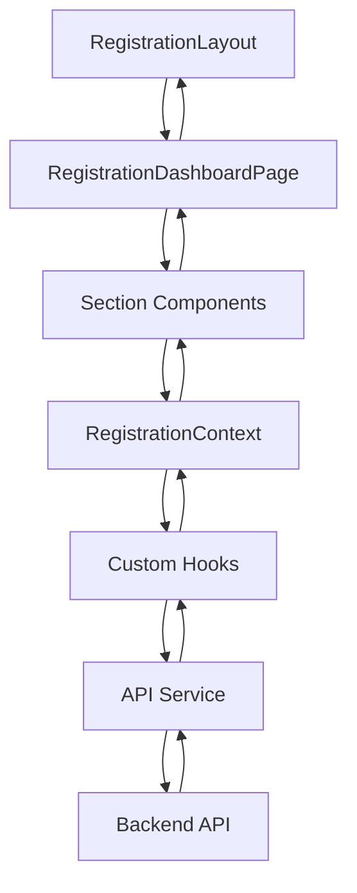

# Registration Feature Architecture

## System Overview

The Registration Feature is a modular, scalable student registration system designed to handle the complete enrollment process for schools. It follows a layered architecture with clear separation of concerns between presentation, business logic, and data access layers.

## Architecture Layers

### Presentation Layer

- **React Components**: TypeScript-based React components using modern hooks pattern
- **Tailwind CSS**: Utility-first CSS framework for responsive, RTL-friendly styling
- **React Router**: Client-side routing for navigation between registration sections
- **TanStack Query**: Data fetching, caching, and synchronization with backend API
- **Form Libraries**: Custom form handling with validation and state management

### Business Logic Layer

- **Custom Hooks**: `useRegistrationSelf`, `useUpdateRegistrationProfile`, etc.
- **Validation Utilities**: National code validation, date formatting, document type validation
- **Progress Calculation**: Dynamic progress tracking across 15 sections
- **State Management**: Context API for global registration state sharing

### Data Access Layer

- **API Service**: `registration.api.ts` with typed endpoints for all registration operations
- **API Client**: Shared HTTP client with authentication and error handling
- **Type Safety**: Comprehensive TypeScript interfaces for all data structures

## Component Structure

```
src/features/registration/
├── RegistrationLayout.tsx          # Main layout with progress bar
├── RegistrationDashboardPage.tsx   # Dashboard with sidebar navigation
├── sections/
│   ├── BasicInformationSection.tsx     # Section 1: Basic info
│   ├── IdentityInformationSection.tsx  # Section 2: Identity docs
│   ├── DocumentsSection.tsx           # Section 3: Document uploads
│   ├── ContactInformationSection.tsx    # Section 4: Contact details
│   ├── FamilyInformationSection.tsx     # Section 5: Family info
│   ├── EducationalBackgroundSection.tsx # Section 6: Academic background
│   ├── HealthInformationSection.tsx     # Section 7: Health info
│   ├── ExtracurricularActivitiesSection.tsx # Section 8: Activities
│   ├── AcademicInterestsSection.tsx     # Section 9: Interests
│   ├── TransportationSection.tsx         # Section 10: Transportation
│   ├── FinancialInformationSection.tsx     # Section 11: Financial info
│   ├── ConsentAndAgreementsSection.tsx   # Section 12: Consents
│   ├── EmergencyContactsSection.tsx      # Section 13: Emergency contacts
│   ├── AcademicHistorySection.tsx        # Section 14: Academic history
│   └── RegistrationCompletionSection.tsx  # Section 15: Completion
├── api/
│   └── registration.api.ts               # API service layer
├── registration.config.ts                # Configuration constants
├── registration.constants.ts             # Route and API endpoint constants
├── registration.context.tsx            # React context for state
├── registration.hooks.ts                 # Custom React Query hooks
├── registration.provider.tsx           # Context provider wrapper
├── registration.router.tsx               # Routing configuration
├── registration.types.ts               # TypeScript interfaces
├── registration.utils.ts               # Utility functions
└── registration.feature.tsx            # Feature metadata and exports
```

## Data Flow Diagram



## Key Design Decisions

### 1. Modular Section Architecture
- Each registration section is implemented as a separate, self-contained component
- Sections can be enabled/disabled independently via configuration
- Easy to add new sections without modifying existing code

### 2. Progressive Enhancement
- Registration starts with basic information and progresses through increasingly detailed sections
- Progress is calculated dynamically based on completed sections
- Users can save partial progress and return later

### 3. Persian RTL Support
- Full right-to-left layout support using Tailwind's RTL utilities
- Persian language localization throughout the interface
- Proper text alignment and direction handling

### 4. Type Safety
- Comprehensive TypeScript interfaces for all data structures
- Strict typing for API responses and request payloads
- Compile-time validation of data structures

### 5. Performance Optimization
- React Query caching for API responses
- Code splitting for individual sections
- Lazy loading of non-critical sections
- Memoization of expensive calculations

## Security Considerations

- All API calls use authenticated requests with proper authorization headers
- Sensitive data (national codes, personal information) is encrypted in transit
- Input validation and sanitization for all user-provided data
- CSRF protection for form submissions
- Secure file upload handling with content-type validation
- Role-based access control for registration features

## Scalability Considerations

- Stateless architecture allows horizontal scaling
- Database indexing optimized for registration queries
- Caching strategy for frequently accessed registration data
- Load testing performed for high-concurrency scenarios
- Monitoring and alerting for registration performance metrics

## Future Architecture Enhancements

- **Microservice Integration**: Break out registration service as independent microservice
- **Event-Driven Architecture**: Use message queue for asynchronous registration processing
- **Server-Side Rendering**: Improve SEO and initial load performance
- **GraphQL API**: Replace REST API with GraphQL for flexible data fetching
- **WebAssembly Integration**: Use WebAssembly for computationally intensive operations
- **Edge Computing**: Deploy registration components to edge locations for global users

## Dependencies

| Dependency | Purpose | Version |
|------------|---------|---------|
| `@tanstack/react-query` | Data fetching and caching | ^4.36.1 |
| `react-router-dom` | Client-side routing | ^6.22.3 |
| `tailwindcss` | Styling framework | ^3.4.1 |
| `@headlessui/react` | UI components | ^1.7.17 |
| `@heroicons/react` | Icons | ^2.1.3 |

## License

MIT License