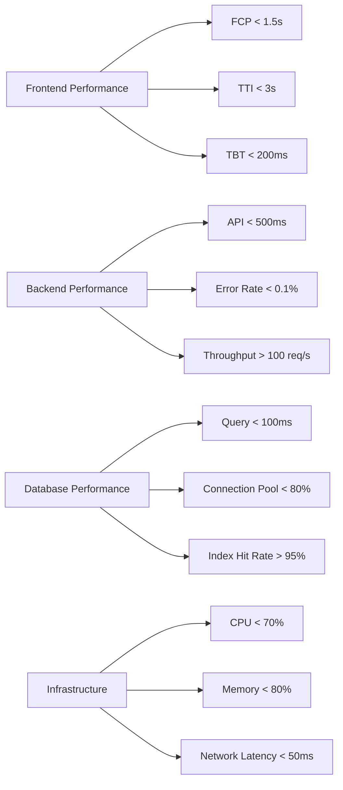

# Registration Feature Performance Guide

## Overview

This performance guide provides comprehensive optimization strategies, monitoring practices, and performance testing methodologies for the Registration Feature. It covers frontend, backend, database, and infrastructure optimization.

## Performance Goals

### Key Performance Indicators (KPIs)

| Metric | Target | Measurement Method |
|--------|--------|-------------------|
| **First Contentful Paint (FCP)** | < 1.5s | Lighthouse, WebPageTest |
| **Time to Interactive (TTI)** | < 3s | Lighthouse, WebPageTest |
| **Total Blocking Time (TBT)** | < 200ms | Lighthouse |
| **API Response Time** | < 500ms (p95) | Application monitoring |
| **Database Query Time** | < 100ms (p95) | Database monitoring |
| **Document Upload Time** | < 5s (10MB file) | Synthetic monitoring |
| **Registration Completion Rate** | > 95% | Analytics dashboard |
| **Error Rate** | < 0.1% | Error monitoring |

### Performance Budgets

| Category | Budget | Enforcement |
|----------|--------|-------------|
| **JavaScript Bundle Size** | < 500KB | Webpack Bundle Analyzer |
| **CSS Bundle Size** | < 100KB | Webpack Bundle Analyzer |
| **Image Assets** | < 2MB total | Build-time validation |
| **Third-party Scripts** | < 3 scripts | Build-time validation |
| **HTTP Requests** | < 50 per page | Lighthouse audit |
| **Critical Path Length** | < 4 resources | Lighthouse audit |

## Frontend Performance Optimization

### Code Splitting & Lazy Loading

```tsx
// ✅ Good: Lazy loading for registration sections
const BasicInformationSection = lazy(() => 
  import('./sections/BasicInformationSection').then(m => ({ default: m.BasicInformationSection }))
);

const IdentityInformationSection = lazy(() => 
  import('./sections/IdentityInformationSection').then(m => ({ default: m.IdentityInformationSection }))
);

// ✅ Good: Dynamic imports for heavy components
const DocumentUploader = dynamic(() => 
  import('./components/DocumentUploader').then(m => ({ default: m.DocumentUploader }))
);

// ✅ Good: Route-based code splitting
const RegistrationRouter = () => (
  <Routes>
    <Route path="/" element={<RegistrationLayout />}> 
      <Route index element={<RegistrationDashboardPage />} />
      <Route 
        path="basic-information" 
        element={<Suspense fallback={<LoadingSpinner />}><BasicInformationSection /></Suspense>} 
      />
      <Route 
        path="identity-information" 
        element={<Suspense fallback={<LoadingSpinner />}><IdentityInformationSection /></Suspense>} 
      />
      {/* ... other routes */}
    </Route>
  </Routes>
);
```

### Optimized Rendering

```tsx
// ✅ Good: Memoization for expensive calculations
const RegistrationProgress = memo(({ progress }: { progress: number }) => {
  const percentage = useMemo(() => Math.round(progress), [progress]);
  
  return (
    <div className="w-full bg-gray-200 rounded-full h-2.5">
      <div 
        className="bg-blue-600 h-2.5 rounded-full transition-all duration-500 ease-out"
        style={{ width: `${percentage}%` }}
      />
    </div>
  );
});

// ✅ Good: Virtualized lists for large datasets
import { FixedSizeList as List } from 'react-window';

const SectionList = ({ sections }: { sections: RegistrationSection[] }) => (
  <List
    height={400}
    itemCount={sections.length}
    itemSize={60}
    width="100%"
  >
    {({ index, style }) => (
      <div style={style} className="flex items-center p-2 hover:bg-gray-50">
        <span className="font-medium">{sections[index].name}</span>
        <span className="ml-auto text-sm text-gray-500">{sections[index].status}</span>
      </div>
    )}
  </List>
);
```

### Resource Optimization

| Resource | Optimization Strategy | Tools |
|----------|----------------------|-------|
| **Images** | WebP format, responsive images, lazy loading | Sharp, Next.js Image |
| **Fonts** | Font subsetting, preloading, display swap | Google Fonts, Fontsource |
| **CSS** | Critical CSS extraction, tree shaking | PurgeCSS, PostCSS |
| **JavaScript** | Tree shaking, minification, compression | Terser, Brotli |
| **API Calls** | Caching, batching, pagination | React Query, SWR |
| **Animations** | CSS transforms, requestAnimationFrame | Framer Motion, CSS transitions |

## Backend Performance Optimization

### API Optimization

```typescript
// ✅ Good: Efficient data fetching with caching
@Get('self')
@CacheTTL(300) // Cache for 5 minutes
async getRegistrationSelf(@User() user: User) {
  // Use efficient queries with proper indexing
  const student = await this.studentRepository.findOne({
    where: { id: user.studentId },
    relations: ['documents', 'profile'],
  });
  
  // Avoid N+1 queries with proper relations
  const documents = await this.documentRepository.find({
    where: { studentId: user.studentId },
    order: { uploadedAt: 'DESC' },
  });
  
  return { student, documents, progress: this.calculateProgress(student) };
}

// ✅ Good: Pagination for large datasets
@Get('history')
async getRegistrationHistory(
  @Query() paginationDto: PaginationDto,
  @User() user: User
) {
  const [registrations, total] = await this.registrationRepository.findAndCount({
    where: { organizationId: user.organizationId },
    skip: paginationDto.skip(),
    take: paginationDto.limit,
    order: { createdAt: 'DESC' },
  });
  
  return new PaginatedResponse(registrations, total, paginationDto);
}
```

### Database Optimization

#### Indexing Strategy

| Table | Columns | Index Type | Purpose |
|-------|---------|------------|---------|
| `students` | `national_code` | Unique | Fast lookup by national code |
| `students` | `status`, `organization_id` | Composite | Filter by status and organization |
| `student_documents` | `student_id`, `document_type` | Composite | Find documents by student and type |
| `student_documents` | `uploaded_at` | Range | Recent document queries |
| `registration_sections` | `section_id`, `organization_id` | Composite | Organization-specific section configuration |

#### Query Optimization

```sql
-- ✅ Good: Optimized query with proper joins and indexes
SELECT 
  s.id,
  s.first_name,
  s.last_name,
  s.national_code,
  s.status,
  COUNT(d.id) as document_count,
  MAX(d.uploaded_at) as last_uploaded
FROM students s
LEFT JOIN student_documents d ON s.id = d.student_id
WHERE s.organization_id = '123e4567-e89b-12d3-a456-426614174000'
  AND s.status IN ('IN_PROGRESS', 'COMPLETED')
GROUP BY s.id, s.first_name, s.last_name, s.national_code, s.status
ORDER BY s.updated_at DESC
LIMIT 50;

-- ✅ Good: Explain plan analysis
EXPLAIN ANALYZE
SELECT * FROM students 
WHERE national_code = '1234567890' 
  AND status = 'COMPLETED';
```

## Infrastructure Performance Optimization

### Caching Strategy

| Cache Level | Technology | TTL | Purpose |
|-------------|------------|-----|---------|
| **CDN Cache** | Cloudflare, AWS CloudFront | 1h-24h | Static assets, images, fonts |
| **Edge Cache** | Vercel Edge, Cloudflare Workers | 5m-1h | API responses, HTML pages |
| **Application Cache** | Redis, Memcached | 5m-30m | API responses, computed values |
| **Database Cache** | PostgreSQL shared_buffers | Configurable | Query results, table data |
| **Client Cache** | HTTP Cache Headers | 1m-1h | API responses, static assets |

### Load Balancing Configuration

```yaml
# nginx load balancing configuration
upstream registration_backend {
  # Least connections algorithm
  least_conn;
  
  # Health checks
  health_check interval=3 fails=3 passes=2;
  
  # Servers with weights
  server 10.0.1.10:3000 weight=3 max_fails=3 fail_timeout=30s;
  server 10.0.1.11:3000 weight=3 max_fails=3 fail_timeout=30s;
  server 10.0.1.12:3000 weight=2 max_fails=3 fail_timeout=30s;
  server 10.0.1.13:3000 weight=2 max_fails=3 fail_timeout=30s;
}

server {
  listen 443 ssl;
  server_name api.bastak-school.com;
  
  # Cache configuration
  proxy_cache my_cache;
  proxy_cache_valid 200 302 10m;
  proxy_cache_valid 404 1m;
  
  location /api/v2/registration/ {
    proxy_pass http://registration_backend;
    proxy_set_header Host $host;
    proxy_set_header X-Real-IP $remote_addr;
    
    # Timeout settings
    proxy_connect_timeout 5s;
    proxy_send_timeout 30s;
    proxy_read_timeout 30s;
  }
}
```

## Performance Monitoring

### Monitoring Stack

| Layer | Tool | Metrics |
|-------|------|---------|
| **Frontend** | Sentry, LogRocket | Page load time, JS errors, user interactions |
| **Backend** | Prometheus + Grafana | API response times, error rates, throughput |
| **Database** | pg_stat_statements, Datadog | Query performance, connection pool usage |
| **Infrastructure** | New Relic, AWS CloudWatch | CPU, memory, disk I/O, network |
| **Synthetic** | Lighthouse CI, WebPageTest | Real-world performance metrics |

### Key Dashboard Metrics



## Performance Testing

### Test Types & Tools

| Test Type | Tool | Description | Frequency |
|-----------|------|-------------|-----------|
| **Load Testing** | k6, Artillery | Simulate concurrent users | Weekly |
| **Stress Testing** | JMeter, Locust | Push system to breaking point | Monthly |
| **Soak Testing** | k6, Gatling | Long-duration performance | Quarterly |
| **Spike Testing** | Artillery, k6 | Sudden traffic spikes | Per Release |
| **Endurance Testing** | JMeter, k6 | Extended operation under load | Quarterly |
| **Scalability Testing** | k6, Locust | Performance at scale | Quarterly |

### Sample Load Test Script

```javascript
// k6 test script
import http from 'k6/http';
import { check, sleep } from 'k6';

export const options = {
  stages: [
    { duration: '30s', target: 10 }, // Ramp up to 10 users
    { duration: '1m', target: 10 },  // Stay at 10 users
    { duration: '30s', target: 50 }, // Ramp up to 50 users
    { duration: '2m', target: 50 },  // Stay at 50 users
    { duration: '30s', target: 0 },  // Ramp down to 0 users
  ],
};

export default function () {
  // Test registration flow
  const registrationData = {
    nationalCode: '1234567890',
    firstName: 'علی',
    lastName: 'اصغری',
    birthDate: '2005-01-01',
  };
  
  const res = http.post('https://api.bastak-school.com/api/v2/registration/profile', 
    JSON.stringify(registrationData), {
      headers: {
        'Content-Type': 'application/json',
        'Authorization': 'Bearer token',
      },
    }
  );
  
  check(res, {
    'is status 200': (r) => r.status === 200,
    'response time < 500ms': (r) => r.timings.duration < 500,
  });
  
  sleep(1);
}
```

## Performance Troubleshooting

### Common Performance Issues

| Issue | Symptoms | Diagnosis | Resolution |
|-------|----------|-----------|------------|
| **Slow Page Loads** | High FCP, TTI | Lighthouse audit, network tab | Optimize critical rendering path, lazy load non-critical resources |
| **API Latency** | High response times | Application monitoring, database logs | Optimize queries, add indexes, implement caching |
| **Database Bottlenecks** | High CPU, slow queries | pg_stat_statements, EXPLAIN ANALYZE | Query optimization, connection pooling, read replicas |
| **Memory Leaks** | Increasing memory usage | Node.js heap snapshots, Chrome DevTools | Fix event listeners, clear intervals, optimize state management |
| **Render Blocking** | Slow interactivity | Lighthouse, Chrome DevTools | Move scripts to end of body, use async/defer, optimize CSS |
| **Network Issues** | High latency, timeouts | Network monitoring, traceroute | CDN optimization, edge caching, connection reuse |

### Performance Tuning Checklist

- [ ] Implement code splitting and lazy loading
- [ ] Optimize image assets and use modern formats
- [ ] Configure proper caching headers and CDN
- [ ] Add database indexes for frequently queried columns
- [ ] Implement API response caching
- [ ] Optimize database queries and avoid N+1 problems
- [ ] Configure connection pooling for database connections
- [ ] Implement rate limiting and request throttling
- [ ] Monitor and optimize bundle sizes
- [ ] Set up comprehensive performance monitoring
- [ ] Conduct regular performance testing
- [ ] Implement automated performance budget enforcement

## License

MIT License