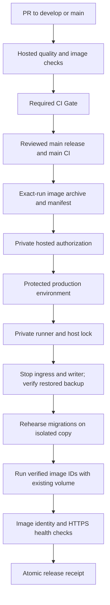

# Immutable LAN releases and incident recovery

Status: staged implementation, automatic activation **disabled by default**. This audit does not change the private deployment repository, environment settings, Tailscale policy, host firewall, Nginx service, production containers or database. Current architecture and verified findings are in the [archived deployment audit](../archive/operations/deployment-audit.md).

## Migration and activation sequence

1. Keep `CI Gate` strict and required on develop/main. CI verifies project-defined typecheck/lint/tests/production builds, API contracts, architecture and disposable HTTPS workflow smoke tests. Hosted runners build commit-tagged images once, test those images, and upload their archive and identity manifest to the exact CI run. No registry or SSH deploy credential is required for this transport.
2. Merge and validate CI changes on develop. Review the entire release diff before promotion to main; main also runs the required gate. Do not merge a release just to enable this infrastructure.
3. Separately review and publish `.github/deployment/server-deploy.yml` to the **private** deployment repository. Configure its `production` environment with reviewers, prevent self-review/bypass where the GitHub plan supports it, and a main-only branch policy. Limit repository and runner administration. No PR/untrusted code may use that runner. Keep its `IMMUTABLE_DEPLOY_ENABLED` variable unset until rehearsal succeeds.
4. Preserve the existing Compose project `bastak-school` and external database volume `bastak-school_moshaver_v2_sqlite`. Inspect mounts before adoption. Put approved `production.env`, TLS and `nginx.conf.template` in `/home/bastak-server/.config/bastak-production`; do not replace existing values automatically. Match runner/runtime UID and restrict this directory to 0700, environment/private keys/backups to 0600. Do not regenerate production certificates during deployment.
5. Rehearse on disposable containers and a verified isolated restoration, including pending migration conflict refusal and failed health checks. The immutable deploy script requires explicit enablement, immutable artifacts, an existing running stack, expected volume, and approved host paths; bootstrap is a separate operator task.
6. Only after review, set `IMMUTABLE_DEPLOY_ENABLED=true` in the private deployment repository and keep source `PRODUCTION_DEPLOY_TARGET=lan`. Use the production environment approval to review SHA, CI run, manifest, backup drill and migration risk. Publishing the new private workflow replaces its old auto-build path; do not run both. This audit neither sets that variable nor publishes the template.

## Release execution

The private workflow checks successful source main-push CI and current main SHA on a hosted runner, waits at the production environment, then rechecks on the private runner. It downloads only the named artifact from that run and rejects missing/expired/digest-mismatched artifacts. Image archives have no production secrets. Canonical image-config digests include runtime configuration and ordered filesystem DiffIDs. Docker classic/containerd stores can report different image IDs for those same bits; the loader verifies exported config digests before accepting such a difference, and records CI and local content IDs in `loaded-images.json`. Artifact retention is finite: archive verified release bundles off-checkout for rollback; rebuilds are a new release, not the same tested image.

`scripts/deploy/lan-immutable.sh` takes the persistent host lock also used by the legacy script. It verifies archive checksum, image IDs and revision labels, loads the tested images, validates Compose without printing expanded environment values, and verifies the expected current database mount. It stops ingress and the API, copies the stopped database file set into backup storage and creates an online-library snapshot using the previous image, verifies a restored copy including integrity/FKs/schema/all logical rows, rehearses candidate migrations against that copy, and rejects loss/change of existing non-migration rows. It then starts the candidate with `--no-build --pull never`, verifies running image IDs, Nginx syntax, TLS, SPA/proxy/API readiness and writes an atomic release receipt. Existing volume identity and records are retained; no volume deletion, reset, seed or schema synchronization occurs in production. Expect maintenance downtime.

Pre-replacement failure restarts the existing stopped containers. Once candidate startup may have migrated the live database, failure stops ingress and requires operator assessment; there is no blind automatic rollback. A restrictive migration compatibility check may reject an intentionally data-transforming migration: require a reviewed policy and rehearsal rather than bypassing preservation checks casually.

## Health strategy

- `/health`: process liveness; `/ready`: readiness including the registered database probe. Neither proves every workflow or schema invariant. Container readiness gates startup; HTTPS `/ready` validates Nginx, TLS and proxy routing.
- Before success, compare each running container `.Image` with the verified local IDs in `loaded-images.json`; a matching tag alone is insufficient. Check Nginx syntax, root HTML, OpenAPI JSON, unauthenticated context rejection, and HTTP-to-HTTPS redirect. Never use `curl -k` for production checks.
- CI alone seeds a disposable stack and exercises login/secure cookie/CSRF, selected context, student records, class roster, attendance retry, dorm placement, schedules and denied student administration. Production probes remain read-only/unauthenticated; synthetic production users and writes need a separate explicit policy.
- Private-network monitoring should poll HTTPS readiness and disk/volume usage, certificate expiry, backup age, restore-drill age and runner service state. Alert on sustained failure and failed deployments. Do not publish readiness details externally. Log rotation exists; external alert delivery/retention is not configured by this change.

## Code rollback

Before the first immutable rollout, retain the current legacy image IDs and export those exact images outside checkout cleanup. Their missing revision/provenance labels must be recorded as legacy evidence, never relabelled as CI-certified. Rehearse the legacy fallback separately: the strict immutable loader will intentionally reject an uncertified legacy bundle. Do not activate until the operator has a compatible first-release fallback and its approved Compose/image-ID override.

Freeze writes and retain the failed release evidence first. Code rollback is allowed only when the previous image is compatible with the **current** schema: rehearse the previous image against a copy of the current database, review every intervening migration and API contract, and preserve stronger additive constraints where compatible. Use the retained verified bundle, its reviewed checkout and the same locked deploy procedure; ordinary dispatch deliberately rejects an old main SHA. Emergency rollback is an operator action, not an unverified repository dispatch. Keep both image IDs and manifests; never deploy `latest`, rebuild old source and claim identical bits, or run `migration:revert` automatically. The newest database migration is additive; older historical migrations may be forward-only.

## Database recovery

1. Put the service in maintenance, stop ingress/API and competing automation, acquire the same host lock, and preserve the failed database **including WAL/SHM** as evidence. Never delete/reset/seed the existing database or run `down --volumes`/volume prune.
2. Choose a verified retained snapshot and explicit recovery point. Snapshot restore discards subsequent writes; agree RPO and a reviewed replay/reconciliation strategy. Copy the backup to a new isolated recovery location and run `database-recovery.cjs verify`, candidate/previous migration rehearsal and authenticated smoke against disposable services. Never write restored test identities into production.
3. Prefer a new separately named recovery volume, populated with the validated restored file and correct UID, over overwriting the original volume. Review the external volume override and switch only after recovery approval. Retain the original untouched volume and evidence; no restore helper in this audit automatically replaces live storage.
4. Start the selected compatible images, verify IDs, FK integrity, HTTPS readiness, authorized login/context and one approved business operation. Record snapshot hash, release/image IDs, recovery point, lost/replayed writes, approver and incident timeline outside the replaced database.

## Backup policy

Deployment snapshots alone are insufficient for RPO. Schedule online SQLite backups with the application/runtime library while live WAL writes continue; never copy only the main file from a running WAL database. Validate each snapshot and regularly restore independently. The supplied helper verifies restored schema and all logical contents, and records only counts/digests, not records. Encrypt off-host copies with separate restore credentials and test retrieval/decryption. Establish measured RPO/RTO, owner, retention (for example daily/weekly/monthly only after requirements), disk budget and alerts. This audit does not install a backup timer, upload private data or delete old backups. Preserve release manifests/images alongside compatible backups. Recovery must work without GitHub artifacts after their expiry.

## Credentials and private access

Use default read-only `GITHUB_TOKEN` for validation. Configure `SOURCE_ARTIFACT_READ_TOKEN` in the private repository's protected `production` environment: a separate fine-grained token restricted to source Actions read and Contents read (or equivalent short-lived GitHub App token). Cross-repository downloads must not depend on a private-repo job token's repository scope. Checkout must not persist credentials. `DEPLOY_DISPATCH_TOKEN` is a separate fine-grained token or GitHub App limited to private-repo Contents write (repository dispatch). `RELEASE_PR_TOKEN` needs source Contents/Pull requests write for branch synchronization; it must never enter PR jobs. Prefer short-lived App tokens, rotate/revoke on expiry/incident, audit usage, and keep secrets in protected environments. Do not print tokens or expanded Compose configuration, use shell tracing, or expose signed artifact URLs.

The private runner already connects outbound to GitHub; no hosted-runner SSH path or new inbound server port is needed. Keep Docker on its Unix socket, never bind unauthenticated TCP 2375/2376, and keep that socket out of app containers. Docker group access is root-equivalent, not least privilege: the current runner needs this existing privilege. A dedicated deploy account/host-controlled allowlisted wrapper or rootless runtime is a separately rehearsed improvement; changing ownership/service accounts blindly would break storage access. No broad sudo or personal administration credential belongs in Actions.

Use Tailscale for operator access with narrowly scoped grants/tags and SSH users, verified host keys (or tested Tailscale SSH policy), no agent forwarding, no root SSH and no shared personal keys. If adding an SSH adapter later, use a forced command with allowlisted SHA/run inputs and no forwarding/PTY; do not hand it unrestricted Docker/shell access. Do not use Funnel or expose a deployment webhook/Docker daemon. Audit existing all-interface SSH/HTTP/HTTPS listeners and Docker-aware firewall rules; Tailscale being active does not prove LAN/public access is restricted. Host firewall, router reachability and tailnet policy require separate verification and reviewed changes.

References: [GitHub artifacts](https://docs.github.com/en/actions/concepts/workflows-and-actions/workflow-artifacts), [GitHub self-hosted runner security](https://docs.github.com/en/actions/security-for-github-actions/security-guides/security-hardening-for-github-actions), [Docker volume identity](https://docs.docker.com/reference/compose-file/volumes/), [Compose trust model](https://docs.docker.com/compose/trust-model/), [Tailscale SSH](https://tailscale.com/docs/features/tailscale-ssh).
